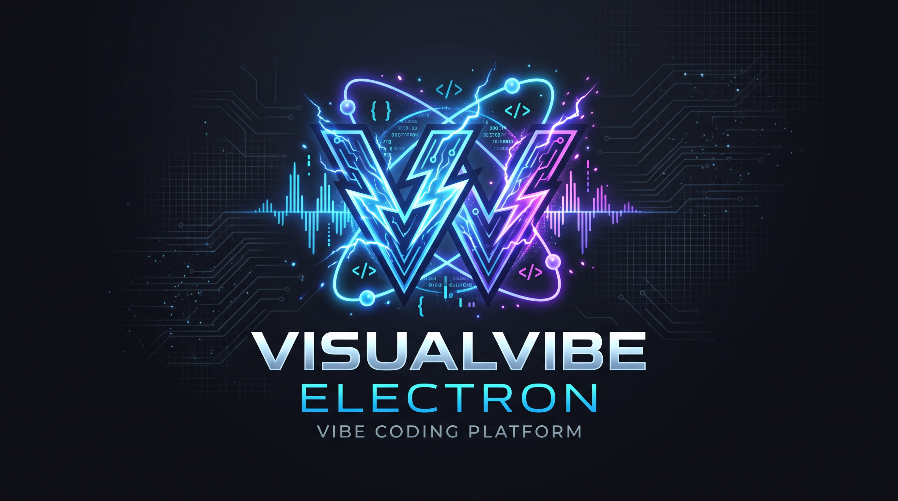

<p align="center">
  
</p>

# VisualVibe Electron

> **The AI-First Cloud Development Environment with Native Remote Desktop Streaming.**

VisualVibe Electron is a modern, containerized Linux development environment accessible directly from any web browser. Combining a native **VSCodium** desktop instance with **KasmVNC** web streaming, **Caddy** reverse proxy, and **Podman-in-Podman** runtime, it delivers the responsiveness and power of a local desktop IDE with complete session persistence and deep autonomous AI integration.

---

## What is VisualVibe?

VisualVibe transforms any modern web browser into a full-featured, persistent development workstation. Instead of running a lightweight web-only editor, VisualVibe runs a full native Linux desktop session inside an isolated container.

Your editors, background compilers, shells, and AI coding agents execute independently of your client connection. You can start a complex coding task, close your laptop, switch networks, or resume from an iPad or workstation hours later — finding your workspace, open terminals, and running agents exactly as you left them.

---

## Key Features

- **True Process & Agent Persistence**  
  Long-running builds, servers, and multi-step AI agent workflows continue running uninterrupted in the background. Disconnecting or closing the browser never cancels your work.

- **Native VSCodium Desktop Experience in Browser**  
  Enjoy a full desktop IDE experience with rich extension support, smooth rendering, crisp text scaling, and native window behaviors streamed via high-performance KasmVNC with adaptive WebP encoding.

- **Built-in Autonomous AI Agent Integration**  
  Pre-configured with Zoo Code and native hooks for any OpenAI-compatible LLM endpoint (OmniRoute, Ollama, LocalAI, vLLM, OpenAI, and more).

- **Nested Podman-in-Podman Sandbox**  
  Execute, test, and build containerized applications safely inside your environment with rootless Podman, keeping your host system pristine.

- **Integrated Web File Manager**  
  Effortlessly upload, download, and organize files and workspaces via the built-in FileBrowser interface accessible at `/filebrowser/`.

- **Production-Ready Ingress & Security**  
  Powered by an integrated Caddy 2 reverse proxy with automatic HTTPS and persistent certificates, ensuring modern browser Secure Context features (like native clipboard synchronization) work seamlessly out of the box.

- **Responsive & Multi-Device**  
  Adaptive dynamic resolution resizing supports single-monitor, dual-monitor, high-DPI (up to 4K), and touch devices.

---

## Primary Use Cases

- **Autonomous AI-Driven Engineering**: Let autonomous agents write code, execute tests in ephemeral containers, and refactor codebases while you monitor or work asynchronously.
- **Anywhere, Any-Device Development**: Turn any browser on an iPad, Chromebook, thin client, or shared computer into a high-powered development workstation.
- **Safe & Disposable Sandboxes**: Safely inspect unknown repositories, test dependencies, and run build pipelines inside isolated nested containers.
- **Standardized Team Onboarding**: Deploy consistent, zero-setup developer environments across your organization in seconds.

---

## Tech Stack

| Layer | Technology | Role |
|---|---|---|
| **Base Operating System** | AlmaLinux 9 | Enterprise-grade, stable Linux foundation |
| **Virtual Display & Windowing** | Xvfb (`:1`) & Openbox | Lightweight headless X11 display and kiosk window management |
| **Remote Desktop Streaming** | KasmVNC 1.3.3 | Low-latency WebP/JPEG video streaming over WebSockets |
| **Editor & IDE** | VSCodium | Native open-source desktop code editor |
| **AI Agent Runtime** | Zoo Code Extension | Built-in autonomous pair-programming assistant |
| **Reverse Proxy & TLS** | Caddy 2 | Automatic HTTPS, HTTP redirects, and unified routing |
| **File Manager** | FileBrowser 1.5.6 | Web-based file explorer and drag-and-drop transfer tool |
| **Container Engine** | Podman 5+ | Nested rootless container runtime for dev tasks |

---

## Network Architecture & Ports

The container exposes three dedicated network ports handled by Caddy:

| Port | Protocol | Purpose |
|---|---|---|
| **80** | HTTP | Automatic permanent redirect to HTTPS on port 443 |
| **443** | HTTPS | Primary web UI with TLS (KasmVNC streaming at `/` and FileBrowser at `/filebrowser/`) |
| **8000** | HTTP | Plain HTTP ingress designed for upstream reverse proxies (Cloudflare Tunnel, Tailscale, NGINX, Traefik) |

---

## Configuration

### Environment Variables

| Variable | Required | Description | Example |
|---|---|---|---|
| `AI_API_URL` | **Yes** | OpenAI-compatible API base URL | `https://api.openai.com/v1` or `http://host.containers.internal:20128/v1` |
| `AI_API_KEY` | **Yes** | API key for the AI model provider | `sk-proj-...` |
| `AI_LANG` | **Yes** | Preferred language for the AI assistant | `en`, `it`, `es`, `fr`, `de` |
| `TZ` | No | Container timezone (default: `UTC`) | `Europe/Rome`, `America/New_York` |
| `CERTFILE_PUBLIC` | No | Path, raw PEM, or base64 string for custom TLS public certificate | `/certs/fullchain.pem` |
| `CERTFILE_PRIVATE` | No | Path, raw PEM, or base64 string for custom TLS private key | `/certs/privkey.pem` |

> **Note:** `AI_API_URL`, `AI_API_KEY`, and `AI_LANG` are strictly validated at container startup. The container will safely halt with an informative message if any of these three are omitted.

### Storage & Persistence

All persistent data (VSCodium workspace, user configuration, extensions, history, and FileBrowser uploads) lives in:

- **`/home/vvelectron`** — Mount a persistent named volume (e.g. `visualvibe-home`) or host directory here.

---

## Getting Started

### Prerequisites

- A Linux, macOS, or Windows host
- **Docker** (with Compose v2) OR **Podman** (v4.5+)
- An OpenAI-compatible API endpoint and key

---

### Option 1: Running with Docker Compose

1. Clone the repository:
   ```bash
   git clone https://github.com/asphalter/visualvibe-electron.git
   cd visualvibe-electron
   ```

2. Review or configure your environment in [`docker-compose.yml`](docker-compose.yml) (or via `.env` file):
   ```yaml
   environment:
     TZ: Europe/Rome
     AI_API_URL: "https://api.openai.com/v1"
     AI_API_KEY: "sk-your-api-key"
     AI_LANG: "en"
   ```

3. Launch the container:
   ```bash
   docker compose up -d --build
   ```

4. Open your browser and navigate to:
   - **HTTPS direct**: `https://localhost` (accept the persistent self-signed certificate on initial access)
   - **File Manager**: `https://localhost/filebrowser/`

---

### Option 2: Running with Podman (CLI & Helper Script)

A ready-to-use launch script [`run_env.sh`](run_env.sh) is included:

```bash
# 1. Set required AI credentials
export AI_API_URL="https://api.openai.com/v1"
export AI_API_KEY="sk-your-api-key"
export AI_LANG="en"

# 2. Launch the environment (builds image if not present)
./run_env.sh
```

To skip rebuilding on subsequent runs:
```bash
./run_env.sh --no-build
```

#### Manual Podman Command

You can also run the container directly using `podman run`:

```bash
# 1. Build the image
podman build -t visualvibe-electron:latest -f Containerfile .

# 2. Run the container
podman run -d \
  --name visualvibe-electron \
  --privileged \
  --shm-size 2g \
  -p 80:80 \
  -p 443:443 \
  -p 8000:8000 \
  -v visualvibe-home:/home/vvelectron:z \
  -e TZ="Europe/Rome" \
  -e AI_API_URL="https://api.openai.com/v1" \
  -e AI_API_KEY="sk-your-api-key" \
  -e AI_LANG="en" \
  visualvibe-electron:latest
```

> **SELinux Notice**: Notice the `:z` flag on the volume mount (`-v visualvibe-home:/home/vvelectron:z`). This ensures proper SELinux context labeling when running rootless Podman on Fedora, AlmaLinux, RHEL, or Rocky Linux.

---

### Option 3: Systemd Service with Podman Quadlet

For production Linux servers, a systemd Quadlet unit file is provided at [`quadlet/visualvibe-electron.container`](quadlet/visualvibe-electron.container).

1. Copy the quadlet files to your user systemd directory:
   ```bash
   mkdir -p ~/.config/containers/systemd/
   cp quadlet/visualvibe-electron.container ~/.config/containers/systemd/
   cp quadlet/visualvibe-home.volume ~/.config/containers/systemd/
   ```

2. Edit `~/.config/containers/systemd/visualvibe-electron.container` to fill in your `AI_API_URL`, `AI_API_KEY`, and `AI_LANG`.

3. Reload systemd and start the service:
   ```bash
   systemctl --user daemon-reload
   systemctl --user start visualvibe-electron
   systemctl --user enable visualvibe-electron
   ```

---

## Connecting Through a Reverse Proxy / Tunnel

If you place VisualVibe behind Cloudflare Tunnel, Tailscale Funnel, NGINX, or Traefik:

- Connect your upstream tunnel directly to container port **`8000`** (Plain HTTP).
- This avoids double TLS encryption and certificate validation issues between your proxy and Caddy while preserving full WebSocket streaming and file transfer capabilities.

---

## License

Distributed under the MIT License. See [`LICENSE`](LICENSE) for more information.
