# Proposta Architetturale — VisualVibe Remote Desktop via Web

> **Versione**: 1.0 draft — 2026-10-17  
> **Baseline**: [`VERSION`](VERSION) `20261012.002`  
> **Stato**: Proposta per revisione

---

## Indice

1. [Sintesi Esecutiva](#1-sintesi-esecutiva)
2. [Analisi dello Stato Corrente](#2-analisi-dello-stato-corrente)
3. [Analisi della Problematicità di Persistenza](#3-analisi-della-problematicità-di-persistenza)
4. [Lezioni Apprese dal Branch ThinClient](#4-lezioni-apprese-dal-branch-thinclient)
5. [Valutazione delle Soluzioni Remote Desktop via Web](#5-valutazione-delle-soluzioni-remote-desktop-via-web)
6. [Proposta Architetturale Raccomandata](#6-proposta-architetturale-raccomandata)
7. [Piano di Realizzazione](#7-piano-di-realizzazione)
8. [Rischi e Mitigazioni](#8-rischi-e-mitigazioni)
9. [Appendici](#9-appendici)
10. [Analisi Tecnica — RDP vs VNC a 4K e Problematiche di Streaming Web](#10-analisi-tecnica--rdp-vs-vnc-a-4k-e-problematiche-di-streaming-web)

---

## 1. Sintesi Esecutiva

### Requisito chiave
L'utente deve poter **avviare task con Zoo Code**, **chiudere il browser**, **riaprirlo da qualsiasi dispositivo dopo un tempo indefinito**, e **ritrovare la sessione esattamente nello stato in cui l'aveva lasciata** — task in esecuzione, prompt, shell, contesto intatti.

### Soluzione proposta
Sostituire l'architettura `code-server` (VS Code web headless) con un'architettura **Remote Desktop via Web** in cui:

1. **VS Code Desktop / VSCodium** gira come applicazione GUI nativa dentro il container, su un display server virtuale (Xvfb/Xdummy).
2. Un **window manager kiosk** minimale (Openbox) contiene la finestra VS Code massimizzata.
3. **KasmVNC** espone il framebuffer via WebSocket + HTML5 nativo, senza gateway aggiuntivi.
4. **Caddy** (già presente) fa da reverse proxy TLS davanti a KasmVNC.
5. Zoo Code funziona come estensione VSIX standard installata su VS Code Desktop — **zero patch al client web**, **zero monkey-patching di bundle**.

### Perché questa soluzione

| Criterio | code-server attuale | ThinClient daemon | **Remote Desktop Web** |
|---|---|---|---|
| Persistenza sessione | ❌ Persa a disconnessione | ✅ Daemon persistente | ✅ Processo GUI sempre vivo |
| Complessità patch | ❌ 13+ script boot, regex su bundle minificati | ❌ Daemon custom + thin client | ✅ **Zero patch** — VSIX standard |
| Aggiornabilità Zoo Code | ❌ Ogni aggiornamento rompe anchor | ❌ Fork/reimplementazione totale | ✅ `code --install-extension zoo.vsix` |
| Aggiornabilità VS Code | ❌ Dipendente da code-server upstream | ❌ Legata al daemon | ✅ Update nativo o Codium RPM |
| Manutenibilità | ⚠️ Debito tecnico elevato | ❌ Insostenibile | ✅ Stack standard, componenti disaccoppiati |
| UX percepita | ✅ Nativa web | ⚠️ Parziale | ✅ Fluida — encoding adattivo JPEG/WebP |

---

## 2. Analisi dello Stato Corrente

### 2.1 Architettura attuale

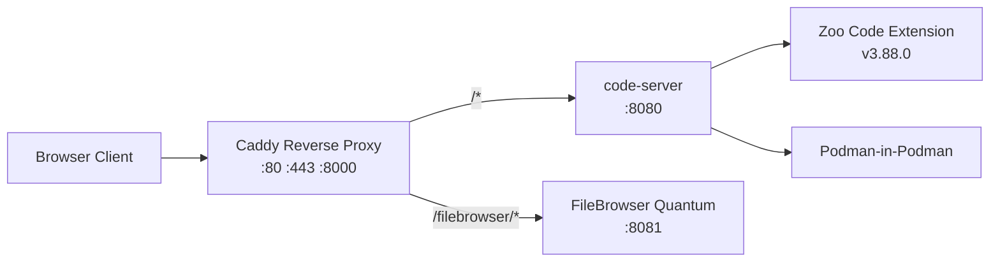

Il container [`Containerfile`](Containerfile) è basato su **AlmaLinux 10** e include:
- **code-server** v4.140.0 — fork headless/web di VS Code
- **Zoo Code** v3.88.0 — estensione AI agent
- **FileBrowser Quantum** — file manager web
- **Caddy** — reverse proxy tri-listener con TLS self-signed
- **Podman** — container runtime nested (privileged mode)
- **Chromium** — per rendering headless (MCP browser tools)

### 2.2 Sistema di patch e personalizzazione

Come documentato in [`scripts/README.md`](scripts/README.md), il sistema usa **13+ script numerati** eseguiti ad ogni boot:

| Script | Funzione | Fragilità |
|---|---|---|
| [`002_zoo-fallback.sh`](scripts/boot/002_zoo-fallback.sh) | Installa Zoo Code se mancante | Bassa |
| [`003_patch-zoo-sidebar.py`](scripts/boot/003_patch-zoo-sidebar.py) | Sposta Zoo Code nella Secondary Side Bar modificando `package.json` | Media — dipende dalla struttura del manifest |
| [`004_patch-workbench-activitybar.py`](scripts/boot/004_patch-workbench-activitybar.py) | Altera la Activity Bar nel workbench compilato | **Alta** — regex su bundle minificato |
| [`005_cache-bust-workbench.py`](scripts/boot/005_cache-bust-workbench.py) | Invalida cache dopo patch | Media |
| [`008_vscode-state-vscdb.py`](scripts/boot/008_vscode-state-vscdb.py) | Manipolazione SQLite `state.vscdb` | **Alta** — schema proprietario non documentato |
| [`011_zoo-seed-profiles.py`](scripts/boot/011_zoo-seed-profiles.py) | Pre-configura profili AI | Media — dipende da struttura interna Zoo Code |
| [`013_verify-patches.py`](scripts/boot/013_verify-patches.py) | Verifica integrità patch | Necessario proprio per la fragilità del sistema |

**Ogni aggiornamento di code-server o Zoo Code** rischia di rompere le anchor regex e richiedere riscrittura manuale degli script.

---

## 3. Analisi della Problematicità di Persistenza

### 3.1 Perché code-server perde la sessione

In code-server, il ciclo di vita dell'estensione VS Code è **legato alla connessione WebSocket del browser client**:

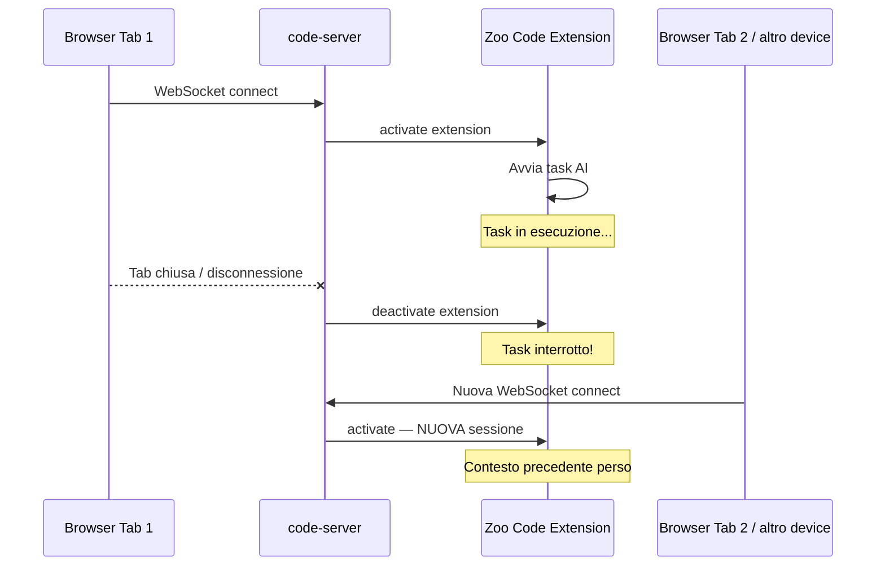

**Cause tecniche specifiche**:

1. **Extension Host lifecycle**: code-server crea un nuovo Extension Host process per ogni connessione client. Quando il client si disconnette, l'Extension Host viene terminato, uccidendo tutti i processi dell'estensione Zoo Code incluso il task runner.

2. **Stato in-memory non persistito**: Zoo Code mantiene lo stato della conversazione, il contesto dei file, e la coda dei tool-use in memoria volatile dell'Extension Host. Non esiste un meccanismo di serializzazione/ripristino dello stato completo.

3. **Terminal multiplexing assente**: I terminali aperti da Zoo Code per eseguire comandi sono PTY legati alla sessione WebSocket. Una nuova connessione ottiene terminali vuoti.

4. **WebSocket affinity**: code-server non supporta session resume o reconnect trasparente — ogni nuova connessione è una sessione completamente nuova.

### 3.2 Perché un Remote Desktop risolve il problema

Con l'approccio Remote Desktop, la separazione è netta:

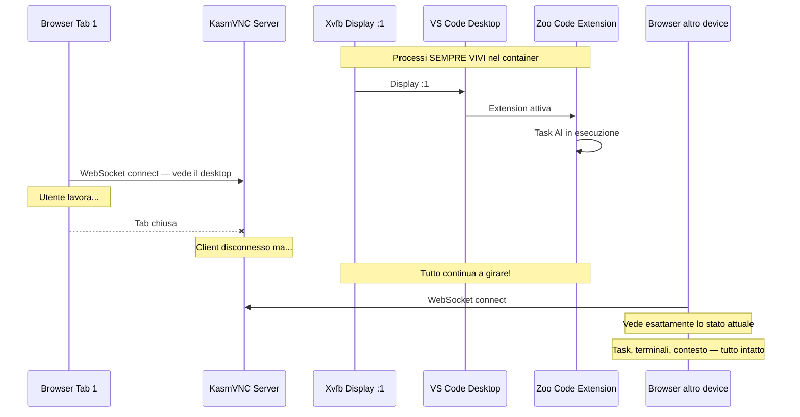

**Il processo VS Code Desktop non viene mai terminato** — gira costantemente su Xvfb. Il client web è solo un visualizzatore del framebuffer. Disconnettersi e riconnettersi equivale a spegnere e riaccendere un monitor.

---

## 4. Lezioni Apprese dal Branch ThinClient

Il branch abbandonato in `/home/vvelectron/VisualVibe Workdirs/VisualVibe Electron ThinClient/` aveva tentato un approccio **daemon persistente + thin client UI**:

- Un **Zoo Daemon** in TypeScript comunicava via UNIX socket con un'estensione thin client [`vv-agent-ui`](/home/vvelectron/VisualVibe Workdirs/VisualVibe Electron ThinClient/extensions/vv-agent-ui/extension.js)
- Il daemon re-implementava il motore di Zoo Code come servizio persistente indipendente
- L'estensione thin client montava la Webview React originale di Zoo Code e fungeva da ponte bidirezionale

### Criticità riscontrate

Documentate nei file [`ANALISI_PATCH_E_FRAGILITA.md`](/home/vvelectron/VisualVibe Workdirs/VisualVibe Electron ThinClient/ANALISI_PATCH_E_FRAGILITA.md) e [`ANALISI_ZOO_CODE_VS_VISUALVIBE.md`](/home/vvelectron/VisualVibe Workdirs/VisualVibe Electron ThinClient/ANALISI_ZOO_CODE_VS_VISUALVIBE.md):

1. **Fork implicito di Zoo Code**: il daemon doveva reimplementare/forkare l'intero motore Zoo Code, rendendo impossibile seguire gli aggiornamenti upstream.
2. **Superficie di integrazione enorme**: ogni feature di Zoo Code (tool loop, context management, MCP, browser automation, diff apply, ecc.) doveva essere mappata 1:1 nel daemon.
3. **Fragilità del ponte Webview**: il thin client doveva intercettare e tradurre messaggi tra la Webview React e il daemon — ogni aggiornamento di Zoo Code poteva rompere il protocollo.
4. **Complessità insostenibile**: l'analisi mostra decine di macro-aree da mappare, con molte in stato parziale o da implementare.

### Lezione chiave

> **Non reimplementare Zoo Code** — usarlo così com'è, come estensione VSIX standard su VS Code Desktop nativo, eliminando completamente il problema dell'integrazione.

---

## 5. Valutazione delle Soluzioni Remote Desktop via Web

### 5.1 Panoramica delle opzioni

| Soluzione | Protocollo | Gateway Web | Architettura | Maturità |
|---|---|---|---|---|
| **A. xrdp + Apache Guacamole** | RDP | Java servlet + Tomcat | 3 componenti separati | Alta |
| **B. xrdp + FreeRDP WebConnect** | RDP | C/WebSocket | 2 componenti | Media |
| **C. KasmVNC** | VNC ottimizzato + WebSocket | Integrato — HTML5 nativo | 1 componente | Alta |
| **D. Selkies / neko** | WebRTC | Integrato | 1 componente | Media-Alta |
| **E. TigerVNC + noVNC** | VNC classico | noVNC JS client | 2 componenti | Alta |

### 5.2 Analisi comparativa dettagliata

#### A. xrdp + Apache Guacamole

**Pro**:
- Protocollo RDP maturo, compressione intelligente, redirect audio/clipboard nativi
- Guacamole è un progetto Apache stabile con ampia community
- Supporta multi-sessione e recording

**Contro**:
- **Overhead architetturale**: richiede JVM + Tomcat + guacd (C daemon) + PostgreSQL/MySQL per sessioni
- **RAM**: Guacamole + Tomcat consumano ~300-500 MB aggiuntivi
- **Complessità operativa**: 3 servizi da orchestrare + database
- **Latenza**: doppio hop — applicazione → RDP → guacd → WebSocket → browser

#### B. xrdp + FreeRDP WebConnect

**Pro**:
- Stack più leggero di Guacamole
- Nativo C, basso footprint

**Contro**:
- Progetto meno maturo, community ridotta
- Documentazione limitata
- Richiede comunque xrdp + display server separatamente

#### C. KasmVNC — RACCOMANDATO

**Pro**:
- **Single binary**: server VNC + web server + HTML5 client integrati
- **Encoding adattivo**: JPEG con quality adattiva per aree in movimento, WebP lossless per testo
- **Performance**: ottimizzato per container, encoding GPU-free, 50ms o meno di latenza su LAN
- **Banda**: 0.5-3 Mbps tipici grazie a dirty region tracking e compressione intelligente
- **RAM**: ~30-80 MB di overhead oltre il framebuffer
- **CPU**: encoding software efficiente, meno del 5% CPU a schermo statico, 10-20% durante scrolling
- **Clipboard**: bidirezionale nativo nel client HTML5
- **Audio**: streaming WebSocket opzionale via PulseAudio e Opus
- **Resize dinamico**: il client web adatta la risoluzione alla finestra browser
- **Autenticazione**: basic auth integrata o JWT
- **Container-native**: immagini Docker ufficiali Kasm, ampiamente usato in produzione
- **Open source**: GPL, sviluppo attivo, fork di TigerVNC con 5+ anni di evoluzione

**Contro**:
- Input method complessi (CJK, composizione) meno fluidi che in un vero browser
- Nessun redirect USB/dispositivi (non necessario per il nostro caso d'uso)
- Il rendering del testo è basato su screenshot del framebuffer, non su font vettoriali del browser — ma con encoding WebP lossless per regioni statiche la qualità è eccellente

#### D. Selkies-GStreamer / neko — WebRTC

**Pro**:
- Latenza potenzialmente più bassa grazie a WebRTC tramite UDP, no TCP head-of-line blocking
- Encoding H.264/VP9 hardware-accelerato se GPU disponibile
- Qualità video eccellente

**Contro**:
- **Richiede GPU** per performance ottimali (encoding software H.264 è CPU-intensive)
- Complessità STUN/TURN per NAT traversal
- Consumo CPU senza GPU: 20-40% continuo per encoding video
- Stack più complesso (GStreamer pipeline, signaling server, coturn)
- Meno adatto a contenuto prevalentemente testuale (ottimizzato per video/3D)

#### E. TigerVNC + noVNC

**Pro**:
- Stack minimale e collaudato
- noVNC è puro JavaScript, zero dipendenze

**Contro**:
- Encoding VNC classico (RRE/Hextile/ZRLE) meno efficiente di JPEG/WebP adattivo
- Banda più alta di KasmVNC per lo stesso contenuto
- Nessun audio integrato
- Clipboard solo testo plain
- Nessun resize dinamico nativo

### 5.3 Benchmark teorico di risorse

| Metrica | code-server attuale | KasmVNC + VS Code Desktop | Guacamole + xrdp | Selkies WebRTC |
|---|---|---|---|---|
| **RAM base** | ~400 MB | ~550-650 MB | ~800-1000 MB | ~600-800 MB |
| **CPU idle** | ~1-3% | ~2-5% | ~3-6% | ~5-15% |
| **CPU attivo** | ~5-15% | ~10-20% | ~10-20% | ~20-40% senza GPU |
| **Banda idle** | ~5-20 KB/s | ~5-30 KB/s | ~5-30 KB/s | ~50-100 KB/s |
| **Banda scrolling** | ~50-200 KB/s | ~0.5-3 MB/s | ~0.5-3 MB/s | ~1-5 MB/s |
| **Latenza percepita** | meno di 10ms nativo | ~30-60ms | ~40-80ms | ~20-40ms |
| **Componenti aggiuntivi** | 0 | Xvfb + Openbox + KasmVNC | Xvfb + xrdp + guacd + Tomcat | Xvfb + GStreamer + STUN |
| **Complessità deploy** | Bassa | **Bassa-Media** | Alta | Media-Alta |

### 5.4 Vantaggio chiave per aggiornabilità

Con il modello Remote Desktop, l'aggiornamento di Zoo Code e VS Code diventa **banale**:

| Operazione | code-server attuale | Remote Desktop |
|---|---|---|
| Aggiornare Zoo Code | Scaricare VSIX, reinstallare, rieseguire 13 script boot, verificare che le patch regex non siano rotte, debug | `code --install-extension zoo-code-X.Y.Z.vsix` — **Fine** |
| Aggiornare VS Code | Aspettare che code-server rilasci una nuova versione, rebuild container, reverificare tutte le patch | `dnf update code` oppure download .rpm — **Fine** |
| Aggiungere estensioni | Via code-server CLI con limitazioni | Marketplace nativo completo |
| Personalizzare UI | Script di patch su bundle / SQLite | `settings.json` standard — nessuna patch |

**Gli script [`003_patch-zoo-sidebar.py`](scripts/boot/003_patch-zoo-sidebar.py), [`004_patch-workbench-activitybar.py`](scripts/boot/004_patch-workbench-activitybar.py), [`005_cache-bust-workbench.py`](scripts/boot/005_cache-bust-workbench.py), [`008_vscode-state-vscdb.py`](scripts/boot/008_vscode-state-vscdb.py) diventano tutti SUPERFLUI** — le stesse personalizzazioni si ottengono con `settings.json` e configurazioni standard di VS Code Desktop.

---

## 6. Proposta Architetturale Raccomandata

### 6.1 Architettura target

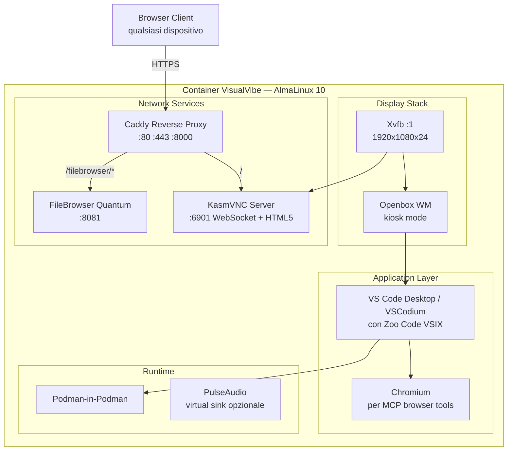

### 6.2 Componenti architetturali

#### 6.2.1 Display Server — Xvfb

- **Xvfb** (X Virtual Framebuffer): crea un display X11 virtuale senza hardware grafico
- Risoluzione iniziale: `1920x1080x24` (ridimensionabile via KasmVNC)
- Alternativa: **Xdummy** (modulo dummy di Xorg) — supporta `xrandr` per resize dinamico senza restart
- **Nota**: Su AlmaLinux 10, `xorg-x11-server-Xvfb` è stato rimosso upstream. Si userà il pacchetto da EPEL o una build statica da Xdummy via `xf86-video-dummy`

#### 6.2.2 Window Manager — Openbox in kiosk mode

- **Openbox**: WM minimale, ~2 MB RAM, configurazione XML
- Modalità kiosk: finestra VS Code massimizzata senza decorazioni, no desktop, no panel
- Configurazione `rc.xml` ultra-minimale:
  - Nessun menu desktop
  - Nessuna barra del titolo per la finestra VS Code
  - Auto-maximize all'avvio
  - Nessuna decorazione finestra

#### 6.2.3 IDE — VS Code Desktop o VSCodium

Due opzioni:

| | VS Code Desktop Microsoft | VSCodium |
|---|---|---|
| Marketplace | Marketplace Microsoft completo | Open VSX Registry |
| Telemetria | Presente, disattivabile | Rimossa |
| Licenza | Proprietaria Microsoft | MIT |
| RPM/binario | `.rpm` ufficiale | `.rpm` da repo community |
| Zoo Code | Compatibile | Compatibile via VSIX |

**Raccomandazione**: **VSCodium** — coerente con la filosofia open source del progetto, nessun tracking, e Zoo Code funziona identicamente via VSIX sideload. Lo switch a VS Code ufficiale è banale se necessario.

#### 6.2.4 Remote Desktop — KasmVNC

- **Porta**: `:6901` (convenzionale per KasmVNC)
- **Protocollo**: WebSocket + HTML5 canvas nativo
- **Encoding**: JPEG adattivo per aree dinamiche, WebP lossless per testo statico
- **Features abilitate**:
  - Clipboard bidirezionale (testo e, facoltativamente, immagini)
  - Resize dinamico della risoluzione in base alla finestra browser
  - Gamepad/keyboard pass-through completo
  - File upload/download via interfaccia web
- **Autenticazione**: delegata a Caddy (basic auth o JWT) oppure auth nativa KasmVNC

#### 6.2.5 Reverse Proxy — Caddy adattato

Il [`Caddyfile`](config/Caddyfile) viene adattato minimalmente:

```
:443 {
    tls /path/to/cert.pem /path/to/key.pem
    
    # KasmVNC — desktop remoto
    handle /* {
        reverse_proxy localhost:6901 {
            # WebSocket upgrade per VNC
            header_up Upgrade {>Upgrade}
            header_up Connection {>Connection}
        }
    }
    
    # FileBrowser — invariato
    handle /filebrowser/* {
        reverse_proxy localhost:8081
    }
}
```

#### 6.2.6 Audio opzionale

- **PulseAudio** con virtual sink, stream Opus via WebSocket integrato in KasmVNC
- Di default **disabilitato** per ridurre overhead, abilitabile via variabile d'ambiente
- Utile solo se l'utente necessita di audio da applicazioni nel container

#### 6.2.7 Podman-in-Podman invariato

- La configurazione privileged mode + `/dev/fuse` + `netavark` rimane identica
- [`containers-storage.conf`](config/containers-storage.conf) invariato

### 6.3 Flusso di avvio rivisto

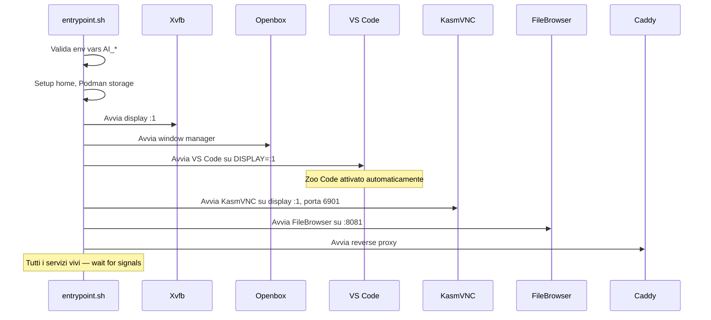

### 6.4 Script di boot semplificati

Con l'architettura Remote Desktop, **molti script boot diventano superflui**:

| Script attuale | Stato nel nuovo modello | Motivo |
|---|---|---|
| [`000_disable-copilot.sh`](scripts/boot/000_disable-copilot.sh) | Mantenuto — applicabile via `settings.json` | VS Code Desktop supporta lo stesso meccanismo |
| [`001_sync-extensions.sh`](scripts/boot/001_sync-extensions.sh) | Semplificato | Installazione VSIX standard |
| [`002_zoo-fallback.sh`](scripts/boot/002_zoo-fallback.sh) | Semplificato | `code --install-extension` nativo |
| [`003_patch-zoo-sidebar.py`](scripts/boot/003_patch-zoo-sidebar.py) | **ELIMINATO** | `settings.json` secondarySidebar nativo |
| [`004_patch-workbench-activitybar.py`](scripts/boot/004_patch-workbench-activitybar.py) | **ELIMINATO** | Nessun bundle da patchare |
| [`005_cache-bust-workbench.py`](scripts/boot/005_cache-bust-workbench.py) | **ELIMINATO** | Nessun workbench web da cachare |
| [`006_preseed-workspace.py`](scripts/boot/006_preseed-workspace.py) | Adattato | Preseed workspace via CLI arg |
| [`007_preseed-rules.py`](scripts/boot/007_preseed-rules.py) | Mantenuto | File system invariato |
| [`008_vscode-state-vscdb.py`](scripts/boot/008_vscode-state-vscdb.py) | **ELIMINATO** | State gestito da VS Code Desktop nativo |
| [`009_sync-settings.sh`](scripts/boot/009_sync-settings.sh) | Semplificato | `settings.json` diretto |
| [`010_filebrowser-branding.sh`](scripts/boot/010_filebrowser-branding.sh) | Invariato | FileBrowser non cambia |
| [`011_zoo-seed-profiles.py`](scripts/boot/011_zoo-seed-profiles.py) | Semplificato | Profili via workspace settings |
| [`012_fix-extension-ownership.sh`](scripts/boot/012_fix-extension-ownership.sh) | Semplificato | Ownership nativa utente |
| [`013_verify-patches.py`](scripts/boot/013_verify-patches.py) | **ELIMINATO** | Nessuna patch da verificare |

**Risultato**: da 14 script boot a ~7-8, con eliminazione completa di tutti quelli basati su regex/patch di bundle e manipolazione SQLite.

### 6.5 Gestione delle estensioni custom VisualVibe

Le estensioni custom attuali:

| Estensione | Stato | Note |
|---|---|---|
| `vv-nav-button` | Rimossa | Sostituita dal pulsante "File Manager" nativo nella sidebar di KasmVNC |
| [`vv-project-picker`](extensions/vv-project-picker/) | Funziona | Estensione VS Code standard, compatibile |
| [`vv-update-checker`](extensions/vv-update-checker/) | Funziona | Estensione VS Code standard, compatibile |

Tutte le estensioni custom sono già pacchettizzate come estensioni VS Code standard — funzioneranno senza modifiche su VS Code Desktop / VSCodium.

---

## 7. Piano di Realizzazione

### Fase 1 — Proof of Concept

- [ ] Creare un `Containerfile.poc` minimale con Xvfb + Openbox + VSCodium + KasmVNC
- [ ] Verificare che Zoo Code v3.88.0 VSIX si installi e funzioni su VSCodium senza patch
- [ ] Verificare persistenza sessione: avviare task Zoo Code, disconnettere, riconnettere, verificare stato intatto
- [ ] Misurare overhead reale: RAM, CPU, banda in condizioni tipiche
- [ ] Verificare clipboard bidirezionale e keyboard mapping italiano
- [ ] Testare resize dinamico della risoluzione

### Fase 2 — Integrazione con stack esistente

- [ ] Adattare il [`Containerfile`](Containerfile) principale per includere lo stack display
- [ ] Rimuovere la dipendenza da code-server
- [ ] Aggiornare [`entrypoint.sh`](entrypoint.sh) con il nuovo flusso di avvio
- [ ] Adattare [`Caddyfile`](config/Caddyfile) per proxare KasmVNC al posto di code-server
- [ ] Migrare le estensioni custom al path di VSCodium
- [ ] Implementare branding KasmVNC: pagina di login custom, favicon, titolo
- [ ] Configurare settings.json e keybindings.json di VS Code con le personalizzazioni attuali

### Fase 3 — Pulizia e produzione

- [ ] Rimuovere gli script boot obsoleti: 003, 004, 005, 008, 013
- [ ] Semplificare gli script rimanenti
- [ ] Aggiornare [`docker-compose.yml`](docker-compose.yml) e [`quadlet/visualvibe-electron.container`](quadlet/visualvibe-electron.container)
- [ ] Aggiornare README e documentazione
- [ ] Aggiornare [`memory-bank/`](memory-bank/) con la nuova architettura
- [ ] Test end-to-end completo: boot, task Zoo Code, persistenza, multi-device, FileBrowser
- [ ] Bump versione

---

## 8. Rischi e Mitigazioni

| # | Rischio | Impatto | Probabilità | Mitigazione |
|---|---|---|---|---|
| R1 | Xvfb non disponibile in AlmaLinux 10 EPEL | Blocca il PoC | Media | Usare Xdummy con `xf86-video-dummy` oppure build statica di Xvfb |
| R2 | Latenza percepita superiore al code-server nativo | Degrado UX | Media | KasmVNC con encoding WebP lossless per testo; quality tuning; compressione zstd |
| R3 | Keyboard mapping errato per layout IT | UX degradata | Bassa | Configurazione xkb layout italiano in Xvfb e mapping KasmVNC |
| R4 | KasmVNC non supporta IME/composizione complessa | Limitazione minore | Bassa | Non critico per il caso d'uso primario — coding |
| R5 | Zoo Code VSIX richiede API VS Code non presenti in VSCodium | Blocca integrazione | Molto Bassa | Zoo Code è già disponibile su Open VSX, quindi è testato su VSCodium. Fallback: VS Code Desktop ufficiale |
| R6 | Consumo RAM aggiuntivo per Xvfb + VS Code Desktop vs code-server | Costo infrastrutturale | Bassa | Delta stimato ~100-200 MB — accettabile. Compensato dalla rimozione dell'overhead degli script di patch |
| R7 | Aggiornamenti KasmVNC introducono breaking changes | Manutenzione | Bassa | Pinnare la versione come già fatto per code-server; aggiornare in modo controllato |

---

## 9. Appendici

### A. Confronto diagrammatico delle tre architetture

```mermaid
graph TB
    subgraph Current[Architettura Attuale — code-server]
        direction LR
        A1[Browser] --> A2[Caddy]
        A2 --> A3[code-server<br/>13+ boot patches]
        A3 --> A4[Zoo Code<br/>patched]
        style A3 fill:#ff9999
        style A4 fill:#ff9999
    end
    
    subgraph Failed[Branch Abbandonato — ThinClient]
        direction LR
        B1[Browser] --> B2[Caddy]
        B2 --> B3[code-server]
        B3 --> B4[vv-agent-ui<br/>thin client]
        B4 -.->|UNIX socket| B5[Zoo Daemon<br/>fork/reimpl]
        style B4 fill:#ff9999
        style B5 fill:#ff9999
    end
    
    subgraph Proposed[Proposta — Remote Desktop Web]
        direction LR
        C1[Browser] --> C2[Caddy]
        C2 --> C3[KasmVNC]
        C3 --> C4[Xvfb + Openbox]
        C4 --> C5[VS Code Desktop<br/>+ Zoo Code VSIX<br/>STANDARD]
        style C3 fill:#99ff99
        style C5 fill:#99ff99
    end
```

### B. Requisiti di pacchetti aggiuntivi nel Containerfile

```dockerfile
# Display stack
RUN dnf install -y \
    xorg-x11-server-Xvfb \
    openbox \
    xdotool \
    xclip \
    && dnf clean all

# KasmVNC — installazione da release binary
ARG KASMVNC_VERSION=1.3.3
RUN curl -fsSL \
    "https://github.com/kasmtech/KasmVNC/releases/download/v${KASMVNC_VERSION}/kasmvncserver_almalinux_10.rpm" \
    -o /tmp/kasmvnc.rpm \
    && rpm -i /tmp/kasmvnc.rpm \
    && rm /tmp/kasmvnc.rpm

# VSCodium
RUN rpm --import \
    https://gitlab.com/paulcarroty/vscodium-deb-rpm-repo/-/raw/master/pub.gpg \
    && printf "[vscodium]\nname=VSCodium\nbaseurl=https://download.vscodium.com/rpms/\nenabled=1\ngpgcheck=1\nrepo_gpgcheck=1\ngpgkey=https://gitlab.com/paulcarroty/vscodium-deb-rpm-repo/-/raw/master/pub.gpg\n" \
    > /etc/yum.repos.d/vscodium.repo \
    && dnf install -y codium
```

### C. Esempio settings.json equivalente alle patch attuali

```jsonc
{
    // Equivalente di 000_disable-copilot.sh
    "github.copilot.enable": false,
    
    // Equivalente delle personalizzazioni UI attuali
    "workbench.activityBar.visible": true,
    "workbench.sideBar.location": "left",
    "window.title": "VisualVibe Electron — ${activeEditorShort}",
    "telemetry.telemetryLevel": "off",
    "security.workspace.trust.enabled": false,
    
    // Zoo Code settings — equivalente di 011_zoo-seed-profiles.py
    "zoo-code.apiUrl": "${env:AI_API_URL}",
    "zoo-code.apiKey": "${env:AI_API_KEY}",
    "zoo-code.language": "${env:AI_LANG}"
}
```

### D. Esempio configurazione Openbox rc.xml kiosk

```xml
<?xml version="1.0" encoding="UTF-8"?>
<openbox_config xmlns="http://openbox.org/3.4/rc">
  <applications>
    <!-- Massimizza VS Code senza decorazioni -->
    <application class="*">
      <decor>no</decor>
      <maximized>yes</maximized>
      <focus>yes</focus>
    </application>
  </applications>
  <desktops>
    <number>1</number>
  </desktops>
  <menu>
    <file>/dev/null</file>
  </menu>
</openbox_config>
```

### E. Selkies WebRTC + GStreamer + STUN — persistenza e Cloudflare

> **Contesto**: questa appendice risponde a due dubbi specifici emersi nella valutazione di Selkies-GStreamer/neko come alternativa a KasmVNC: la persistenza della sessione al cambio di viewer e la fattibilità del trasporto WebRTC dietro Cloudflare.

#### E.1 Persistenza della sessione: l'app è disaccoppiata dalla PeerConnection

L'architettura Selkies-GStreamer è composta da tre livelli con cicli di vita indipendenti:

| Livello | Processo | Ciclo di vita |
|---|---|---|
| Applicazione | VSCodium su Xvfb/Xdummy `:1` + Openbox | Vivo finché vive il container |
| Cattura/Encoding | pipeline GStreamer (screenshare → H.264/VP9 → WebRTC bin) | Avviata/arrestata in base ai peer |
| Trasporto | PeerConnection WebRTC + signaling server | Effimero, per singolo viewer |

La **PeerConnection** è solo un viewer di trasporto: quando il browser si chiude o perde rete, ICE rileva il fallimento della connettività (disconnect → failed), la sessione DTLS/SRTP viene chiusa e Selkies mette la pipeline GStreamer in stato `NULL` o `PAUSED` per liberare CPU/GPU. **L'X server e VSCodium non vengono toccati**: continuano a elaborare, a eseguire i task Zoo Code e a renderizzare sul display virtuale.

Quando un nuovo browser si collega:
1. il signaling server negozia una nuova offerta/risposta SDP;
2. ICE ricostruisce una nuova coppia di candidate;
3. la pipeline GStreamer torna in `PLAYING`;
4. la cattura riparte dal **framebuffer corrente**, mostrando esattamente lo stato che l'app ha raggiunto nel frattempo.

**Conclusione**: sì, VSCodium continua a lavorare in background; sì, un utente può riconnettersi da un altro browser/workstation e ritrovare la sessione esattamente nello stato lasciato. La persistenza è garantita dal processo nel container, non dal viewer. Questo comportamento è identico a quello di KasmVNC: la differenza tra i due è solo il trasporto (WebRTC vs WebSocket), non il modello di persistenza.

#### E.2 WebRTC dietro Cloudflare: due piani di rete con destini diversi

WebRTC separa nettamente due canali:

| Piano | Protocollo | Contenuto | Cloudflare CDN L7 | Cloudflare Tunnel |
|---|---|---|---|---|
| Signaling | HTTPS / WebSocket | offerte SDP, candidate ICE | ✅ passa | ✅ passa |
| Media | RTP / SRTP su UDP | flussi audio/video | ❌ non proxato | ⚠️ solo con WARP o setup speciale |

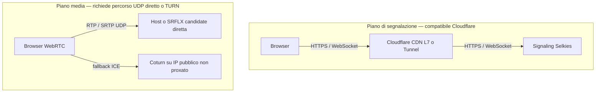

##### E.2.1 Requisiti di trasporto del media WebRTC

La connettività del media viene risolta da ICE attraverso tre famiglie di candidate:

- **Host candidate**: indirizzi IP locali del server. Funzionano solo in rete locale, inutili su internet.
- **Server Reflexive candidate (srflx)**: scoperti interrogando un server STUN; mappano l'IP pubblico e la porta UDP dietro il NAT.
- **Relay candidate (relay)**: forniti da un server TURN, che inoltra i media quando la connessione diretta è impossibile.

Per funzionare su internet, quindi, il server Selkies deve essere raggiungibile direttamente via UDP su una porta pubblica (host/srflx) oppure deve esistere un **server TURN separato** su IP pubblico con porte UDP/TCP aperte.

##### E.2.2 Limiti del proxy Cloudflare CDN L7 (orange cloud)

Il proxy HTTP/S di Cloudflare supporta **HTTP, HTTPS e WebSocket** — ma non inoltra **UDP arbitrario** né TCP non-HTTP. Il risultato è asimmetrico:

- Il **signaling** WebSocket passa senza problemi, quindi l'interfaccia di negoziazione funziona.
- Il **media UDP** non ha un percorso L7: il browser non può inviare RTP/SRTP attraverso il proxy arancione. Serve una di queste vie:
  - **IP pubblico diretto** del server con porte UDP esposte, lasciando Cloudflare a gestire solo il frontend HTTPS/signaling (i media bypassano Cloudflare);
  - **TURN server pubblico** (Coturn) su un hostname/IP non proxato, con porte UDP e TCP aperte;
  - **Cloudflare Spectrum** (prodotto Enterprise) per proxare le porte UDP/TCP dei media;
  - **TURN-over-TLS/TCP sulla porta 443** con hostname in modalità **DNS-only (grey cloud)** oppure IP diretto, perché il proxy L7 standard non inoltra TURNS.

##### E.2.3 Limiti di Cloudflare Tunnel (cloudflared)

`cloudflared` inoltra HTTP/HTTPS e WebSocket verso un'origine privata senza esporre porte pubbliche. Per l'UDP:

- esiste il supporto tunnel UDP, ma **dal lato client richiede WARP** o un'app che parli il protocollo UDP del tunnel;
- un **browser WebRTC standard non usa WARP** per il trasporto media, quindi il flusso RTP/SRTP UDP non è trasparente.

In pratica, con Cloudflare Tunnel il signaling di Selkies funziona ma il media richiede comunque un percorso esterno (IP diretto, TURN o Spectrum), vanificando la semplicità del tunnel.

##### E.2.4 TURN-over-TLS e Coturn

Coturn può terminare TURN su **TCP 443 con TLS (TURNS)**. Questo è utile per attraversare firewall che bloccano l'UDP, ma **non è automaticamente compatibile con il proxy arancione**: TURNS è TCP puro non-HTTP, quindi il proxy L7 non lo inoltra. Le opzioni reali sono:

- puntare il TURN su un **hostname grey-cloud (DNS-only)** o su un IP diretto;
- usare **Cloudflare Spectrum** per il forwarding TCP/UDP;
- mantenere il TURN su una porta UDP/TCP standard senza proxy Cloudflare.

##### E.2.5 Confronto con KasmVNC

KasmVNC incapsula **tutto** — controllo, input, framebuffer, clipboard e audio — in una singola connessione **WebSocket su HTTPS/TCP 443**. Questo lo rende nativamente compatibile con qualsiasi proxy L7, incluso Cloudflare CDN e Cloudflare Tunnel, senza porte UDP aggiuntive, senza STUN/TURN e senza configurazioni di rete speciali.

| Aspetto | Selkies WebRTC | KasmVNC |
|---|---|---|
| Trasporto | WebSocket per signaling + RTP/SRTP UDP per media | WebSocket TCP unico |
| Porte esposte | HTTP/signaling + range UDP media o TURN | 6901 WebSocket |
| Cloudflare CDN L7 | Signaling sì, media no | Completo |
| Cloudflare Tunnel | Signaling sì, media no senza WARP | Completo |
| NAT traversal | STUN/TURN obbligatorio fuori LAN | Non necessario |
| Configurazione aggiuntiva | Coturn, porte UDP, Spectrum | Nessuna |

**Implicazione pratica per VisualVibe**: poiché l'infrastruttura è pensata per essere esposta dietro Cloudflare, KasmVNC rappresenta la scelta operativamente più semplice. Selkies WebRTC resta valido per LAN ad alta qualità o dove esiste una topologia di rete dedicata con IP pubblico/TURN, ma introduce complessità di rete che il modello monolitico WebSocket di KasmVNC elimina alla radice.

#### E.3 Il fallback TCP di Selkies-GStreamer: ICE-TCP e TURNS non sono HTTP

> **Risposta diretta al dubbio**: Selkies-GStreamer **non ha un fallback applicativo su HTTP/HTTPS/WebSocket**. Il "TCP" che si legge in documentazione è il fallback **ICE-TCP / TURN-over-TCP / TURN-over-TLS**, cioè connettività WebRTC su TCP grezzo, non un incapsulamento dei media dentro HTTP. È esattamente qui che la catena Cloudflare CDN (L7) si spezza.

##### E.3.1 Dove vive il "fallback TCP" in Selkies-GStreamer

Selkies-GStreamer non implementa un proprio stack ICE: delega la connettività a **GStreamer `webrtcbin`**, che a sua volta usa **libnice** per l'ICE. I meccanismi TCP disponibili operano tutti a livello L4 e trasportano payload binari STUN/RTP, mai richieste HTTP:

| Meccanismo | Standard | Trasporto reale | Payload | Passa da Cloudflare CDN L7? |
|---|---|---|---|---|
| ICE-TCP | [RFC 6544](https://datatracker.ietf.org/doc/html/rfc6544) | TCP grezzo con framing STUN/RTP a 2-byte length ([RFC 4571](https://datatracker.ietf.org/doc/html/rfc4571)) | binario | ❌ |
| TURN su TCP | [RFC 6062](https://datatracker.ietf.org/doc/html/rfc6062) (con TURN [RFC 5766](https://datatracker.ietf.org/doc/html/rfc5766)/[8656](https://datatracker.ietf.org/doc/html/rfc8656)) | TCP grezzo verso Coturn | binario | ❌ |
| TURN-over-TLS (schema `turns:`) | [RFC 7065](https://datatracker.ietf.org/doc/html/rfc7065) | TLS su TCP, tipicamente porta 443 | binario STUN/TURN incapsulato in TLS | ❌ |
| STUN over DTLS | [RFC 7350](https://datatracker.ietf.org/doc/html/rfc7350) | DTLS su UDP | binario | ❌ (è UDP) |

I parametri TURN di Selkies-GStreamer, esposti via variabili come `SELKIES_TURN_PROTOCOL`, `SELKIES_TURN_TLS` e `SELKIES_TURN_HOST/PORT/USERNAME/PASSWORD`, configurano **esattamente** queste voci: dicono a libnice di raccogliere candidate TCP o relay TURNS, ma il risultato resta una connessione TCP/TLS con framing STUN, non una sessione HTTP.

> **Punto chiave**: la dicitura "TCP/HTTPS" è fuorviante. "HTTPS" qui indica al massimo che la porta è la 443 e che c'è TLS, ma il contenuto della connessione **non è HTTP**: non ci sono `GET`, `POST` o `Upgrade: websocket`. Un proxy L7 come Cloudflare CDN non può inoltrarlo.

> **Nota di precisione sui browser**: nel browser la via TCP più affidabile è **TURN-TCP/TURNS via Coturn**. Il supporto a ICE-TCP come host candidate è irregolare tra i motori (Chrome in particolare privilegia il relay TURN rispetto a candidate TCP attive), quindi in produzione il "fallback TCP" di Selkies si traduce quasi sempre in un **TURN server obbligatorio**.

##### E.3.2 La distinzione insormontabile: L4 binario vs L7 HTTP

```text
Browser → RTCPeerConnection
   ├─ UDP (host/SRFLX):  RTP/SRTP ................ L4
   ├─ ICE-TCP:           framing STUN/RTP ........ L4
   └─ TURN/TURNS:        framing STUN/TURN ....... L4
                             ↓
Cloudflare CDN (orange cloud) = proxy HTTP/HTTPS/WebSocket (L7)
   ├─ riconosce solo request/response HTTP
   └─ i payload binari STUN/TURN non sono HTTP → HTTP 400 / RST
```

WebRTC nel browser (`RTCPeerConnection`) **non incapsula** RTP/SRTP dentro frame WebSocket: il WebSocket serve solo al signaling SDP/ICE. I media seguono il percorso ICE (UDP, ICE-TCP o TURN), che è binario a livello L4. Questo è un vincolo del protocollo standard, non una scelta di Selkies.

##### E.3.3 Cosa succede davvero nel percorso Browser → Cloudflare → Caddy → Container

1. Il browser contatta il dominio su **TCP 443** per il signaling: Cloudflare termina TLS, vede una richiesta HTTP/WebSocket valida e la inoltra a [`config/Caddyfile`](config/Caddyfile) → container. ✅
2. Il browser prova poi le candidate media:
   - **UDP**: Cloudflare CDN non inoltra UDP arbitrario → scartato. ❌
   - **ICE-TCP / TURN-TCP / TURNS su 443**: Cloudflare termina TLS ma riceve un payload **binario STUN/TURN** (non HTTP), quindi rigetta con `HTTP 400` o `RST`. ❌
3. Se il dominio è in modalità **DNS-only (grey cloud)**, Cloudflare fa solo DNS e il browser raggiunge **direttamente** Caddy sull'IP di origine: qui è Caddy a decidere.
4. **Caddy standard** è un proxy L7: sa fare HTTP e WebSocket. Per terminare ICE-TCP/TURNS sulla stessa porta 443 insieme a HTTPS serve il modulo non-standard **`caddy-l4`** (multiplexing per SNI/ALPN). Questo funziona **solo** se il client arriva direttamente all'IP (grey cloud o IP diretto), perché un orange-cloud L7 non lascia mai passare il binario fino a Caddy.

##### E.3.4 Cloudflare Tunnel (`cloudflared`)

`cloudflared` con ingress HTTP/HTTPS/WebSocket funziona solo per il signaling. Il raw TCP (`cloudflared access tcp`) richiede un **client-side agent (WARP o cloudflared access)** che il browser standard non usa. Quindi anche con Tunnel il media Selkies non arriva senza un percorso esterno.

##### E.3.5 Alternative con media 100% in WebSocket/HTTP (compatibili con Cloudflare CDN)

| Progetto | Trasporto media | Compatibile Cloudflare CDN/Tunnel + Caddy? |
|---|---|---|
| KasmVNC | WebSocket su HTTPS/TCP 443 (JPEG/WebP) | ✅ |
| Apache Guacamole | WebSocket su HTTPS/TCP 443 (guacd) | ✅ |
| noVNC (TigerVNC) | WebSocket su HTTPS/TCP 443 (VNC in WS) | ✅ |
| Selkies-GStreamer | **WebRTC nativo** (UDP/ICE-TCP/TURN) | ❌ senza IP diretto/TURN/Spectrum |

I primi tre non sono "WebRTC incapsulato in HTTP": sono streaming basati su **WebSocket + canvas/MSE/WebCodecs**, nativamente L7, e quindi attraversano Cloudflare CDN e Caddy senza configurazioni speciali.

##### E.3.6 Cosa fare in pratica se si vuole Cloudflare + Caddy

- **Scelta A (consigliata)**: usare **KasmVNC** — un solo WebSocket L7, nessuna porta UDP/TURN, funziona con Cloudflare CDN e Caddy standard.
- **Scelta B (se serve per forza WebRTC/Selkies)**: separare i piani:
  - frontend/signaling su dominio **orange cloud** via Caddy;
  - media/TURN su **hostname grey-cloud (DNS-only)** o IP diretto, con **Coturn** esposto su UDP 3478/TCP 3478 e **TURNS su 443**;
  - oppure **Cloudflare Spectrum** (Enterprise) per il forwarding TCP/UDP dei media.
- **Scelta C (bypass Cloudflare per i media)**: Caddy con `caddy-l4` su IP diretto/grey-cloud per terminare TURNS/ICE-TCP insieme a HTTPS, consapevoli che l'orange-cloud L7 non partecipa a questo percorso.

---

## 10. Analisi Tecnica — RDP vs VNC a 4K e Problematiche di Streaming Web

> **Contesto**: Questa sezione risponde ai dubbi emersi dall'esperienza empirica con KasmVNC + Caddy + Openbox transitando tramite Cloudflare su uno schermo **4K** (3840×2160), dove si osservavano rallentamenti, artefatti grafici (rettangoli neri) e latenza percepita elevata. L'ipotesi dell'utente era che **RDP utilizzi primitive di disegno vettoriali/GDI** anziché pixel bitmap, riducendo banda e artefatti.

### 10.1 RDP invia primitive di disegno o bitmap con Electron/VS Code?

#### 10.1.1 Come funziona il rendering di Electron/Chromium

Electron (e quindi VS Code) **non** utilizza le primitive di disegno del window system sottostante (X11 `XDrawRectangle`, `XRenderComposite`, GDI `BitBlt`, `TextOut` ecc.). Il rendering avviene interamente dentro il processo Chromium attraverso questa pipeline:

```
Chromium Content → Blink Layout Engine → Skia 2D ──→ GPU Rasterization (OpenGL/Vulkan)
                                                  └─→ Software Rasterization (CPU fallback)
                                          ↓
                              Framebuffer bitmap composito
                                          ↓
                           Xlib/XCB: XPutImage / XShmPutPixmap
                           (un singolo rettangolo bitmap per
                            l'intera finestra, nessuna primitiva)
```

**Punti chiave**:

- **Skia** è la libreria di rasterizzazione 2D di Google. Tutto — testo, SVG, bordi, ombre, gradienti — viene rasterizzato internamente a bitmap RGB/RGBA.
- Chromium usa il **GPU compositing** multi-layer: ogni layer CSS viene rasterizzato indipendentemente, poi composito dalla GPU. Il risultato è un unico buffer di pixel.
- Verso X11, Electron/Chromium espone **una singola X Window** in cui scrive bitmap complete tramite `XShmPutPixmap` (shared memory) o `XPutImage`. **Non emette alcuna primitiva X11 ad alto livello**.
- Questo significa che dal punto di vista del display server (Xvfb, Xorg, Xdummy), VS Code è una **finestra opaca che aggiorna rettangoli di pixel** — esattamente come un video player o un gioco.

#### 10.1.2 Cosa trasmette effettivamente xrdp su Linux

Su Linux, `xrdp` usa il backend **`xorgxrdp`** — un modulo Xorg che cattura il framebuffer:

```
VS Code (Electron/Skia)
    ↓ XShmPutPixmap (bitmap)
Xorg con modulo xorgxrdp
    ↓ Intercetta damage regions (rettangoli modificati)
    ↓ Comprime i rettangoli bitmap con:
    │   ├─ RemoteFX (RFX) — compressione wavelet DWT a blocchi 64×64
    │   ├─ NSCodec — compressione lossless per aree statiche
    │   ├─ RFX Progressive — raffinamento progressivo (prima bassa qualità, poi dettagli)
    │   └─ Planar bitmap — fallback non compresso
    ↓
Protocollo RDP (TCP/UDP)
    ↓
Client RDP (decompressione + rendering)
```

**La verità tecnica**: con applicazioni Electron/Chromium su Linux, **xrdp NON trasmette primitive vettoriali/GDI**. Trasmette **rettangoli bitmap compressi** delle regioni danneggiate (damage tracking). Il protocollo RDP *supporta* primitive GDI ad alto livello, ma queste vengono generate solo da applicazioni Windows native che usano la GDI API — cosa che Electron/Chromium non fa, nemmeno su Windows.

> **Verdetto**: L'ipotesi che RDP usi "comandi vettoriali" per VS Code è **tecnicamente errata**. Sia KasmVNC che xrdp, con Electron, operano sulla stessa base: **compressione e trasmissione di rettangoli bitmap** delle regioni modificate del framebuffer.

#### 10.1.3 Perché allora RDP nativo sembra più fluido?

La percezione di maggiore fluidità di RDP nativo (es. `mstsc`, Remmina) rispetto a KasmVNC via browser è reale, ma le ragioni sono diverse dalle primitive GDI:

| Fattore | Client RDP nativo | KasmVNC via browser |
|---|---|---|
| **Trasporto** | TCP + UDP nativo (UDP per dati video, TCP per controllo) | WebSocket su TCP (no UDP) |
| **Decodifica** | GPU hardware del client (RemoteFX decode via DXVA/VAAPI) | CPU del browser (Canvas 2D / JavaScript) |
| **Latenza di compositing** | Rendering diretto su framebuffer del display | Browser → Canvas → Compositing CSS → GPU |
| **Adaptive bitrate** | Protocollo nativo con feedback loop a ~60fps | Dipendente da implementazione JavaScript |
| **Congestione di rete** | Controllo di flusso RDP nativo, prioritizzazione pacchetti | Soggetto a buffering TCP e WebSocket framing |
| **Codifica** | RemoteFX/RFX Progressive wavelet (efficiente su testo) | JPEG adattivo + WebP (meno efficiente su testo) |

### 10.2 Accesso Web vs Client RDP Nativo

#### 10.2.1 Come funziona un Web Gateway RDP

Qualsiasi soluzione che espone RDP via browser web (Apache Guacamole, FreeRDP WebConnect, Cloudflare Browser Rendering) segue questa architettura:

```mermaid
graph LR
    subgraph Server
        App[VS Code / Electron]
        Xorg[Xorg + xorgxrdp]
        XRDP[xrdp server]
    end

    subgraph Gateway[Web Gateway - es. Guacamole]
        guacd[guacd - demone C]
        Servlet[Servlet Java / Proxy]
    end

    subgraph Client[Browser Client]
        WS[WebSocket]
        Canvas[Canvas HTML5]
        JS[JavaScript decoder]
    end

    App -->|bitmap| Xorg
    Xorg -->|RDP protocol| XRDP
    XRDP -->|RDP TCP| guacd
    guacd -->|Guacamole protocol| Servlet
    Servlet -->|WebSocket| WS
    WS --> JS
    JS -->|drawImage| Canvas
```

**Il collo di bottiglia critico**: il gateway **decodifica** il flusso RDP (RemoteFX wavelet → bitmap) lato server, poi **ricodifica** in un formato adatto al browser (PNG/JPEG/WebP) e lo trasmette via WebSocket. Questa doppia transcodifica:

1. **Annulla i vantaggi di RDP**: la compressione RemoteFX efficiente viene decodificata e ricodificata con perdita
2. **Aggiunge latenza**: decode server-side + encode + WebSocket framing + decode browser-side
3. **Consuma CPU doppia**: sul server per transcodifica, sul client per decode JavaScript

#### 10.2.2 Client RDP nativo vs Web

| Aspetto | Client RDP Nativo | Web Gateway RDP | KasmVNC diretto |
|---|---|---|---|
| **Catena di encoding** | 1 encode, 1 decode | 1 encode + 1 transcode + 1 decode | 1 encode, 1 decode |
| **Trasporto** | TCP + UDP nativo | WebSocket TCP | WebSocket TCP |
| **Decodifica client** | GPU hardware | CPU JavaScript | CPU JavaScript |
| **Latenza aggiuntiva** | Nessuna | +15-40ms per transcode | Nessuna |
| **Qualità percepita 4K** | Eccellente | Degradata | Dipendente da tuning |
| **Installazione client** | Richiede app | Solo browser | Solo browser |

> **Conclusione**: Un **Web Gateway RDP** (Guacamole) non offre vantaggi prestazionali rispetto a KasmVNC diretto — anzi, la doppia transcodifica lo rende potenzialmente peggiore. Il vantaggio di RDP si manifesta **solo con client nativi**.

### 10.3 Analisi del Problema 4K + Cloudflare + Rettangoli Neri

#### 10.3.1 Dimensione del problema a 4K

| Risoluzione | Pixel totali | Frame grezzo RGBA | @30fps grezzo | @60fps grezzo |
|---|---|---|---|---|
| 1920×1080 (FHD) | 2.07 MPx | 8.3 MB | 249 MB/s | 498 MB/s |
| 2560×1440 (QHD) | 3.69 MPx | 14.7 MB | 442 MB/s | 885 MB/s |
| 3840×2160 (4K) | 8.29 MPx | 33.2 MB | 995 MB/s | 1991 MB/s |

Anche con compressione JPEG quality 60-80, un frame 4K pesa **200-800 KB**. A 30fps le aree attive possono generare **3-10 Mbps** di traffico sostenuto, con picchi durante scroll e animazioni fino a **15-25 Mbps**.

#### 10.3.2 Il meccanismo di sub-tiling di KasmVNC e i rettangoli neri

KasmVNC divide il framebuffer in **tile** (tipicamente 64×64 o 128×128 pixel) e opera così:

```
1. Damage detection: Xvfb segnala le regioni modificate
2. Tile marking: i tile che intersecano le regioni danneggiate vengono marcati dirty
3. Tile encoding: ogni tile dirty viene compresso (JPEG/WebP/ZRLE)
4. Tile queuing: i tile compressi vengono accodati per la trasmissione WebSocket
5. Tile transmission: invio sequenziale via WebSocket
6. Client rendering: il browser decodifica e disegna ogni tile sul Canvas
```

**Quando la pipeline si intasa** (banda insufficiente, CPU encoding satura, WebSocket backpressure), KasmVNC applica una strategia di **tile dropping**:

- I tile più vecchi nella coda vengono scartati per far posto ai nuovi
- Il client non riceve l'aggiornamento per quei tile
- Il risultato visivo è un **rettangolo nero** o un tile con il contenuto precedente stale
- Successivamente, un full-frame refresh riallinea lo stato — ma nel frattempo l'utente vede artefatti

A 4K il numero di tile è **~4x rispetto a FHD**: da ~510 tile (1920/64 × 1080/64) a ~2025 tile (3840/64 × 2160/64). La probabilità di saturazione della pipeline cresce esponenzialmente.

#### 10.3.3 Il ruolo di Cloudflare

Cloudflare introduce ulteriori criticità specifiche per streaming WebSocket ad alto bitrate:

1. **WebSocket buffering**: Cloudflare non è un proxy trasparente per WebSocket. Ogni frame WebSocket viene bufferizzato, ispezionato (anche con il WAF disattivato per la rotta) e ritrasmesso. Questo aggiunge **10-50ms di latenza** per frame.

2. **Burst throttling**: Cloudflare applica rate limiting implicito sui WebSocket. Un burst a 15+ Mbps può triggerare il de-prioritization del flusso, causando rallentamenti temporanei.

3. **TCP Head-of-Line blocking**: WebSocket su TCP eredita il problema HOL. Se un pacchetto TCP viene perso, **tutti** i tile successivi si bloccano in attesa della ritrasmissione — anche se il loro contenuto è indipendente. A 4K con molti tile in volo, l'impatto è devastante.

4. **Timeout di connessione**: con flussi sostenuti ad alto bitrate, Cloudflare può chiudere la connessione WebSocket se rileva pattern anomali nel traffico. Questo causa disconnessioni intermittenti.

5. **Assenza di QoS**: Cloudflare tratta tutti i frame WebSocket con la stessa priorità. Non c'è modo di segnalare che i tile del centro schermo (dove l'utente sta guardando) hanno priorità maggiore rispetto ai bordi.

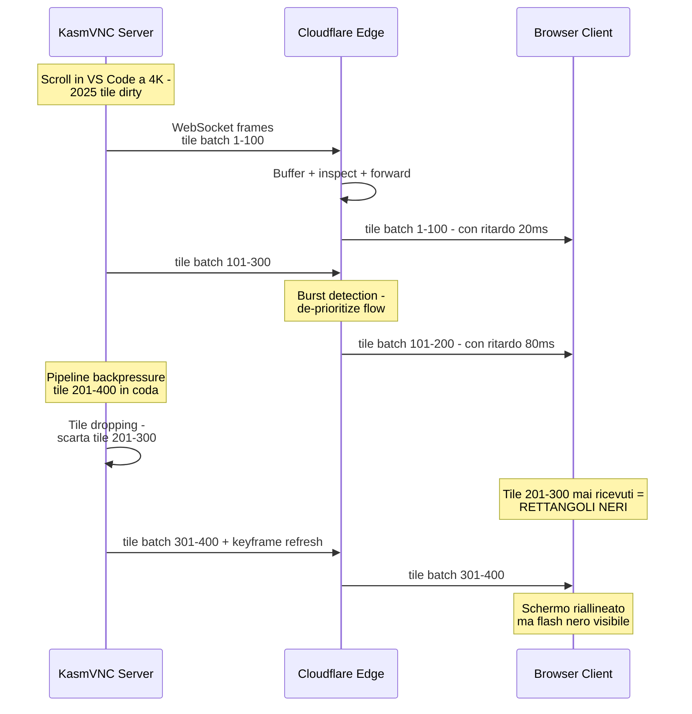

### 10.4 Strategie e Soluzioni Concrete per 4K

#### 10.4.1 Soluzione A — WebRTC nativo per video streaming

WebRTC è progettato specificamente per streaming media in tempo reale e risolve **strutturalmente** i problemi di KasmVNC via WebSocket:

| Aspetto | WebSocket + Canvas (KasmVNC) | WebRTC |
|---|---|---|
| **Trasporto** | TCP — HOL blocking | UDP (SRTP/DTLS) — tollerante a packet loss |
| **Encoding** | JPEG/WebP tile-by-tile | H.264/VP8/VP9/AV1 — video codec hardware |
| **Decode client** | JavaScript CPU | Browser nativo, GPU hardware accelerato |
| **Adaptive bitrate** | Manuale o assente | Nativo (REMB, Transport-CC, congestion control) |
| **Cloudflare** | Buffering + throttling WebSocket | Bypass completo — UDP diretto server↔client |
| **Rettangoli neri** | Sì, per tile dropping | No — degradazione graduale qualità, mai nero |
| **Latenza** | 50-150ms tipica | 16-50ms tipica |
| **Efficienza 4K** | ~10-25 Mbps per movimento | ~2-8 Mbps per movimento (H.264 High Profile) |

**Implementazioni concrete**:

- **Selkies-GStreamer** (già menzionato nella sezione 5): cattura il framebuffer X11 o Wayland, lo codifica con GStreamer (H.264 VAAPI/NVENC per hardware, x264 per software) e lo trasmette via WebRTC con un web client HTML5 integrato. Supporta anche input bidirezionale (tastiera, mouse, clipboard, audio).
- **neko** (già menzionato): architettura simile ma con focus su multi-utente e sincronizzazione.

**Limitazione critica per VisualVibe**: WebRTC bypassa Cloudflare (che è il proxy di sicurezza), richiedendo:
- Apertura di porte UDP (range STUN/TURN) — potenzialmente non consentito sull'hosting
- Un TURN server come fallback TCP — che reintroduce parte dei problemi
- Configurazione network più complessa

**Raccomandazione WebRTC**: ✅ **Soluzione tecnicamente superiore**, ma richiede valutazione dell'infrastruttura di rete. Se l'hosting permette traffico UDP diretto (o via TURN server dedicato), WebRTC è la scelta ottimale per 4K.

#### 10.4.2 Soluzione B — Scaling della risoluzione di rendering

Anziché trasmettere 4K nativo (3840×2160), renderizzare a risoluzione inferiore con DPI scaling:

| Strategia | Risoluzione rendering | DPI Scale | Risultato percepito | Riduzione bandwidth |
|---|---|---|---|---|
| FHD + scale 2x | 1920×1080 | `--force-device-scale-factor=2` | Testo grande e chiaro, meno area di lavoro | 4x |
| QHD + scale 1.5x | 2560×1440 | `--force-device-scale-factor=1.5` | Buon compromesso | 2.25x |
| QHD nativo | 2560×1440 | 1.0 | Area ridotta ma nativo | 2.25x |
| 4K con quality JPEG bassa | 3840×2160 | 1.0 | Artefatti JPEG visibili su testo | 1x |

**Implementazione pratica**:
```bash
# Nel entrypoint.sh, configurare Xvfb a QHD
Xvfb :1 -screen 0 2560x1440x24 &

# Avviare VSCodium con DPI scale
codium --force-device-scale-factor=1.5 --display=:1
```

Combinato con tuning KasmVNC:
```ini
# kasmvnc.yaml
desktop:
  resolution:
    width: 2560
    height: 1440
  allow_resize: true

encoding:
  rect_encoding_mode:
    min_quality: 7       # Alzare qualità minima
    max_quality: 9
    consider_lossless_quality: 8
  max_frame_rate: 30     # Limitare a 30fps - riduce banda del 50%
  
network:
  websocket_max_buffer: 16384  # Buffer WebSocket più grande
```

**Raccomandazione scaling**: ✅ **Soluzione pragmatica e immediatamente applicabile**. QHD (2560×1440) con `--force-device-scale-factor=1.5` è il miglior compromesso per testo chiaro su monitor 4K con banda 4x inferiore rispetto a 4K nativo.

#### 10.4.3 Soluzione C — Opzione duale: Web Client + RDP Nativo

Offrire due modalità di accesso in parallelo, permettendo all'utente di scegliere:

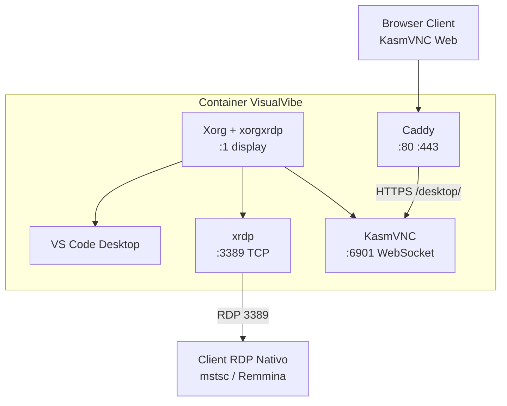

**Vantaggi**:
- Utenti desktop/laptop con monitor 4K usano il client RDP nativo per la migliore esperienza
- Utenti mobile/tablet/dispositivi altrui usano l'accesso web
- La sessione è condivisa — entrambi vedono lo stesso display X11

**Svantaggi**:
- Esporre la porta 3389 richiede sicurezza aggiuntiva (firewall, VPN, o Cloudflare Tunnel TCP)
- `xorgxrdp` e KasmVNC devono condividere lo stesso Xorg, e la coesistenza richiede configurazione attenta
- Complessità operativa doppia

**Raccomandazione duale**: ⚠️ **Fattibile ma complessa**. Consigliata solo se la user base ha un segmento significativo di utenti 4K desktop che necessitano esperienza nativa.

### 10.5 Raccomandazione Finale

Sulla base dell'analisi tecnica, la strategia raccomandata è un **approccio progressivo a 3 livelli**:

#### Livello 1 — Immediato: Scaling + Tuning KasmVNC
- Rendering a **2560×1440** con `--force-device-scale-factor=1.5` su Electron
- Tuning aggressivo KasmVNC: quality 7-9, max 30fps, buffer WebSocket aumentato
- Questa singola modifica riduce il bandwidth richiesto del 75% e elimina la maggior parte degli artefatti
- **Impatto**: Nessun cambio architetturale, solo parametri di configurazione

#### Livello 2 — Medio termine: Valutazione WebRTC
- PoC con Selkies-GStreamer in parallelo a KasmVNC
- Test su infrastruttura reale con Cloudflare per verificare la fattibilità UDP/TURN
- Se positivo, sostituire KasmVNC con Selkies-GStreamer per qualità 4K nativa
- **Impatto**: Cambio del componente di streaming, architettura display invariata

#### Livello 3 — Opzionale: RDP Nativo come accesso alternativo
- Solo se richiesto da utenti specifici con setup 4K professionale
- Esporre `xrdp` via Cloudflare Tunnel TCP o VPN dedicata
- **Impatto**: Porta aggiuntiva, configurazione security separata

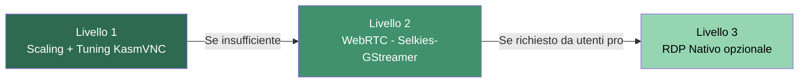

> **Sintesi categorica**: L'ipotesi che RDP utilizzi primitive vettoriali per VS Code è **errata** — entrambi (VNC e RDP) trasmettono bitmap compresse con damage tracking. La superiorità percepita di RDP deriva dal **trasporto UDP nativo**, dalla **decodifica GPU hardware** del client nativo, e dal **protocollo di congestion control integrato**. Qualsiasi gateway web (Guacamole) annulla questi vantaggi. La soluzione più efficace a 4K nel breve termine è il **rendering a risoluzione inferiore con DPI scaling**, con evoluzione verso **WebRTC** nel medio termine.
